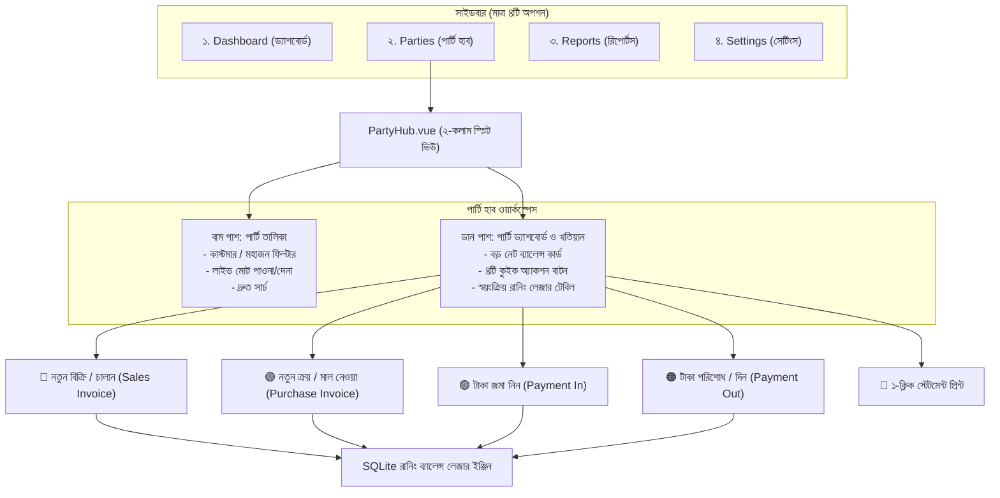

# নিভো (Nivo) অ্যাপের চূড়ান্ত পার্টি-সেন্ট্রিক (Party-Centric) সিস্টেম কাঠামো ও আর্কিটেকচারাল নির্দেশিকা

> **উদ্দেশ্য:** প্রথাগত ইআরপি (ERP)-এর মতো জটিল ও বিচ্ছিন্ন মেনুসমূহ সম্পূর্ণ পরিহার করে অ্যাপ্লিকেশনের সাইডবারকে সর্বোচ্চ হালকা, আধুনিক ও পরিচ্ছন্ন করা। অপ্রয়োজনীয় কোনো সেকশন থাকবে না; পুরো অ্যাপ্লিকেশনটি পরিচালিত হবে মাত্র **৪টি মূল মেনু** দিয়ে।

---

## ১. সাইডবার কাঠামো সরলীকরণ (Minimal 4-Item Sidebar)

বর্তমান অ্যাপসের অনেকগুলো অতিরিক্ত ও জটিল মেনু (যেমন: `Sales`, `Purchases`, `Common`, `Accounts`, `HR`, `Inventory`, `POS`, এবং জটিল `Setup` ড্রপডাউন) সাইডবার থেকে স্থায়ীভাবে মুছে ফেলা হবে।

### সাইডবারে শুধুমাত্র যে ৪টি মেনু থাকবে:
```
┌─────────────────────────────────────────────────────────────┐
│                      NIVO DESKTOP                           │
├─────────────────────────────────────────────────────────────┤
│                                                             │
│  📊 Dashboard (ড্যাশবোর্ড)                                  │
│     └── রুট: / (ব্যবসার সারসংক্ষেপ ও ক্যাশফ্লো)              │
│                                                             │
│  👥 Parties (পার্টি / ডিজিটাল খাতা)                          │
│     └── রুট: /parties (কাস্টমার ও মহাজনদের লাইভ হাব)        │
│                                                             │
│  📑 Reports (রিপোর্টস)                                      │
│     ├── General Ledger (খতিয়ান)                             │
│     ├── Profit and Loss (লাভ-লোকসান)                        │
│     ├── Balance Sheet (ব্যালেন্স শিট)                       │
│     └── Trial Balance (রেওয়ামিল)                            │
│                                                             │
│  ⚙️ Settings (সেটিংস)                                       │
│     └── রুট: /settings (কোম্পানি সেটিংস ও ডাটাবেস ব্যাকআপ)  │
│                                                             │
├─────────────────────────────────────────────────────────────┤
│  [ইউটিলিটি সেকশন - নিচে ফিক্সড]                             │
│  🔄 Update (ইন-অ্যাপ অটো-আপডেট)                             │
│  ⌨️ Shortcuts (কীবোর্ড শর্টকাট)                              │
│  💽 Change DB (ডাটাবেস পরিবর্তন)                            │
└─────────────────────────────────────────────────────────────┘
```

---

## ২. সিস্টেম আর্কিটেকচার ও ডেটা ফ্লো (System Architecture)



---

## ৩. প্রতিটি সেকশনের বিস্তারিত কার্যপদ্ধতি

### ৩.১ Dashboard (ড্যাশবোর্ড)
* **উদ্দেশ্য:** দোকানের সামগ্রিক আর্থিক চিত্র এক নজরে দেখা।
* **ফিচার:**
  * মোট বিক্রি ও নগদ ক্যাশ ইনফ্লো।
  * মোট বকেয়া পাওনা (Total Receivables) এবং মোট বকেয়া দেনা (Total Payables)।
  * মাসিক আয়-ব্যয় গ্রাফ।

---

### ৩.২ Parties (পার্টি — মূল কর্মক্ষেত্র)
দোকানের কেনাবেচা ও টাকা লেনদেনের **১০০% কাজ এই একটি পেজ থেকেই সম্পন্ন হবে**:

#### ক. বাম কলাম (পার্টি তালিকা — ৩৫% প্রস্থ)
* **কাউন্টার ও নতুন বাটন:** মোট পার্টি সংখ্যা এবং `+ নতুন পার্টি (+ Add Party)`।
* **ফিল্টার পিলস:** `সব (All)`, `কাস্টমার (Customer)`, `মহাজন (Supplier)`।
* **ব্যালেন্স ফিল্টার:** `বাকি পাওনা (To Receive)`, `বাকি দেনা (To Give)`, `পরিশোধিত (Settled)`।
* **পার্টি কার্ড:** নাম, মোবাইল নম্বর এবং বড় হরফে লাইভ ব্যালেন্স (সবুজ রঙে পাওনা, লালচে রঙে দেনা)।

#### খ. ডান কলাম (পার্টি ড্যাশবোর্ড — ৬৫% প্রস্থ)
* **হেডার সামারি:**
  * পার্টির নাম, মোবাইল, ঠিকানা এবং উভয়মুখী রোল ট্যাগ (`Customer` / `Supplier` / `Both`)।
  * **বড় নেট ব্যালেন্স কার্ড:** সব হিসাবের পর আসল বাকি কত তা স্পষ্ট দেখতে পাওয়া যাবে।
* **কুইক অ্যাকশন বাটনসমূহ:**
  1. 🟢 **`টাকা জমা নিন (Payment In)`** — কাস্টমার নগদ/ব্যাংকে টাকা দিলে। কোনো ইনভয়েস সিলেক্ট করতে হবে না; শুধু টাকার অঙ্ক দিলে স্বয়ংক্রিয়ভাবে পার্টির মোট বাকি কমে যাবে।
  2. 🔵 **`নতুন বিক্রি / চালান (New Sale)`** — কাস্টমারকে বিভিন্ন মালামাল বিক্রি করলে সরাসরি চালান কাটবেন। চালান সেভ হলে পার্টির বাকি যোগ হবে।
  3. 🟠 **`টাকা দিন (Payment Out)`** — মহাজনকে টাকা পরিশোধ করলে।
  4. 🟣 **`নতুন ক্রয় চালান (New Purchase)`** — মহাজনের থেকে মালামাল কিনলে।
  5. 📄 **`স্টেটমেন্ট প্রিন্ট (Print Statement)`** — ১-ক্লিকে গ্রাহকের ফুল খতিয়ান A4 বা থার্মাল স্লিপ প্রিন্ট।
* **স্বয়ংক্রিয় রানিং লেজার খতিয়ান:**
  * কলাম: `তারিখ | চালান/রসিদ নং | পণ্য মূল্য (Debit) | জমা টাকা (Credit) | অবশিষ্ট মোট বাকি (Running Balance) | মন্তব্য`।

---

### ৩.৩ Reports (রিপোর্টস)
* **উদ্দেশ্য:** হিসাবের গভীর অডিট ও আনুষ্ঠানিক প্রতিবেদন তৈরি।
* **রিপোর্টসমূহ:**
  * `General Ledger`: পূর্ণাঙ্গ খতিয়ান।
  * `Profit and Loss`: লাভ-লোকসান হিসাব।
  * `Balance Sheet`: উদ্বৃত্তপত্র / সম্পদ ও দায়ের বিবরণী।
  * `Trial Balance`: রেওয়ামিল।

---

### ৩.৪ Settings (সেটিংস)
* **উদ্দেশ্য:** জটিল 'Setup' ড্রপডাউনের বিকল্প হিসেবে একটিমাত্র পরিচ্ছন্ন সেটিংস স্ক্রিন।
* **ফিচার:**
  * কোম্পানির নাম, ঠিকানা, লোগো ও কারেন্সি (টাকা)।
  * **এক-ক্লিকে ডাটাবেস ব্যাকআপ (Download / Backup Database)** বাটন।

---

## ৪. উভয়মুখী পার্টি (Customer + Supplier) অটো-ব্যালেন্সিং

* একই ব্যক্তির নামে দুটি খাতা থাকবে না। পার্টির ফাইলে `role = "Both"` থাকবে।
* সিস্টেম স্বয়ংক্রিয়ভাবে বিক্রি ও ক্রয়ের মধ্যে কাটাকাটি (Contra Netting) করবে:
  $$\text{Net Balance} = (\text{মোট বিক্রি} - \text{বিক্রির জমা}) - (\text{মোট ক্রয়} - \text{ক্রয়ের পরিশোধ})$$
* বিক্রি বেশি হলে এক নজরে **সবুজ রঙে পাওনা**, আর কেনা বেশি হলে **লালচে রঙে দেনা** দেখাবে।

---

## ৫. অন্য ইঞ্জিনিয়ারিং এজেন্টের জন্য টেকনিক্যাল চেকলিস্ট (Action Items)

1. **সাইডবার ক্লিনআপ (`src/utils/sidebarConfig.ts`):**
   - `getCompleteSidebar()` থেকে `Sales`, `Purchases`, `Common`, `Accounts`, `HR`, `Inventory`, `POS`, `Get Started` এবং জটিল `Setup` ড্রপডাউন বাদ দিয়ে শুধু `Dashboard`, `Parties`, `Reports`, এবং `Settings` রিটার্ন করা।
2. **পার্টি হাব পেজ (`src/pages/PartyHub/PartyHub.vue`):**
   - Master-Detail ২-কলাম স্প্লিট ভিউ তৈরি করা।
   - রানিং ব্যালেন্স এবং কুইক অ্যাকশন বাটন যুক্ত করা।
3. **রাউটার কনফিগারেশন (`src/router.ts`):**
   - `/parties` এবং `/parties/:name` রুট চালু করা।
4. **সহজ পেমেন্ট মোডাল (`QuickPaymentModal.vue`):**
   - ইনভয়েস অ্যালোকেশন ছাড়া সরাসরি লেজারে ক্রেডিট/ডেবিট পোস্টিং দেওয়া।
5. **যাচাইকরণ (Verification):**
   - `yarn typecheck` এবং `bash scripts/test-nivo.sh` চালিয়ে ব্যাকএন্ড ও লেজার পোস্টিংয়ের নির্ভুলতা নিশ্চিত করা।
